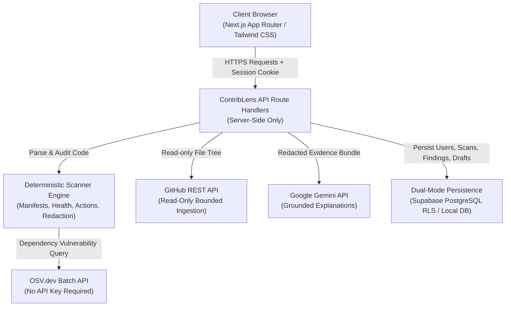

# ContribLens OSS

> **Formal Name**: ContribLens OSS  
> **Tagline**: *Scan. Understand. Contribute.*

ContribLens helps beginners discover meaningful open-source contribution opportunities by scanning public GitHub repositories, verifying security/dependency/health findings via deterministic analysis & OSV, explaining them in plain English with grounded Gemini, and turning verified findings into actionable contribution plans and maintainer issue drafts.

---

## 🧭 The Problem ContribLens Solves

New contributors often struggle with two major obstacles when approaching open source:
1. **Uncertainty about where to start**: Large codebases are intimidating, and finding bite-sized, high-impact issues is challenging without deep repository context.
2. **Hallucination & security risks**: Generic AI tools invent code issues, propose unverified security claims, or risk leaking repository secrets and executing untrusted code.

ContribLens bridges this gap with an **evidence-first pipeline**:
```text
Public GitHub Scan → Deterministic Verification → OSV Enrichment → Grounded AI Explanation → Contribution Route → Test Plan → Maintainer-Ready Issue Draft
```

---

## 🗺️ User Journey & Key Features

1. **Reference Landing Page (`/`)**: Explains the 4-step workflow (Scan, Verify, Understand, Contribute) with code-faded visual motifs and trust messaging.
2. **Robust Multi-Identifier Auth (`/signup`, `/login`)**:
   - Supabase Auth with PostgreSQL Row Level Security (RLS).
   - Multi-field registration: Email, E.164 normalized Phone number, Password with live strength meter, and Terms & Conditions consent.
   - Dual-identifier login: sign in with either Email or Phone number + Password. Generic error responses prevent account enumeration.
3. **Command Dashboard (`/dashboard`)**: Displays repository scan history, verified findings breakdown, active contribution routes, and technology snapshot.
4. **Bounded Repository Scanner (`/scan`)**:
   - Accepts public GitHub URLs.
   - Enforces strict read-only bounds: max 60 files, 180 KB per file, 3 MB total, 20,000 tree entries.
   - **Never executes repository code.**
5. **Verified Findings Detail (`/findings/[findingId]`)**:
   - Complete 18-point verification breakdown: evidence, rule ID, confidence, severity, scanner limits, required skills, target files, verification tests, and acceptance criteria.
6. **AI Grounded Explanations**:
   - Server-only Gemini API integration that strictly requires pre-verified evidence.
   - Rejects unevidenced claims and unknown finding references.
   - Deterministic template fallback when API keys are absent.
7. **Contributions + Stack (`/contributions`)**:
   - Interactive Contribution Impact Graph and deterministic Contribution Readiness scoring (0–100).
   - Technology stack signals with tracked file sources and confidence ratings.
8. **Issue Drafts Management (`/drafts`)**:
   - Full CRUD: Create, Edit title, Edit markdown body, Edit labels, Save draft, Copy to clipboard, Download `.md`, and Delete.
   - **Safety Disclosure Block**: Findings with secrets or critical vulnerabilities automatically enter `DISCLOSURE_BLOCKED` state to prevent accidental public disclosure.
   - Clear banner stating drafts are for human review and never auto-published.
9. **Profile & Safety Center (`/profile`, `/security`, `/safety`)**:
   - User settings, theme toggles, font size/family, reduced-motion controls.
   - Live Integration Diagnostics status card.
   - Account activity log and data export/clear controls.

---

## 🏛️ System Architecture



---

## 🔒 Security & Safety Model

- **Read-Only Ingestion**: ContribLens NEVER executes code from scanned repositories (`npm install`, `python setup.py`, etc.).
- **Zero Raw Secrets**:
  - API keys (`GEMINI_API_KEY`, `SUPABASE_SERVICE_ROLE_KEY`, `GITHUB_TOKEN`) are strictly server-only.
  - High-entropy tokens, PATs, AWS keys, and webhooks in scanned repos are masked immediately in memory (`ghp_****`, `[REDACTED_AWS_SECRET_KEY]`).
  - Evidence hashes use SHA-256 digests over redacted strings.
- **AI Grounding Guarantees**:
  - Gemini receives only pre-verified findings with redacted evidence.
  - Gemini cannot change severity, cannot change confidence, and cannot introduce new findings.
- **Manual Maintainer Review**:
  - ContribLens never auto-publishes issues or auto-opens pull requests on external repositories.

---

## 📋 Deterministic Scanner Rules

| Rule ID | Category | Detection Method |
| :--- | :--- | :--- |
| `GH-ACTIONS-WRITE-ALL` | CI/CD Supply Chain | Flags top-level or job `permissions: write-all` |
| `GH-ACTIONS-UNPINNED` | CI/CD Supply Chain | Flags actions referenced by mutable tags (e.g., `@v3`) rather than full 40-char commit SHAs |
| `GH-ACTIONS-PULL-REQUEST-TARGET`| CI/CD Supply Chain | Flags untrusted checkout triggers with PR target context |
| `GH-ACTIONS-CURL-PIPE-SHELL` | CI/CD Supply Chain | Flags unverified `curl \| bash` or `wget \| sh` pipelines |
| `GH-ACTIONS-SCRIPT-INJECTION` | CI/CD Supply Chain | Flags unescaped inline template expansions in run scripts (`${{ github.event.* }}`) |
| `REPO-MISSING-SECURITY` | Governance | Missing `SECURITY.md` or `.github/SECURITY.md` |
| `REPO-MISSING-LICENSE` | Governance | Missing `LICENSE` or `LICENSE.md` |
| `REPO-MISSING-CONTRIBUTING` | Governance | Missing `CONTRIBUTING.md` |
| `REPO-WEAK-README` | Governance | `README.md` is empty or under 50 characters |
| `REPO-NO-TEST-SIGNAL` | Repository Health | Absence of test directories or test scripts |
| `SECRET-PATTERN-*` | Credentials | High-entropy secrets and credential regexes (PATs, AWS keys, Slack tokens) |
| `OSV-VULN-*` | Dependencies | Bounded manifest parsing (`package.json`, `requirements.txt`, `pyproject.toml`) queried against OSV.dev |

---

## ⚡ Prerequisites & Quickstart

### Prerequisites
- Node.js >= 20.0.0
- npm >= 10.0.0

### 1. Clone & Install
```bash
git clone https://github.com/contriblens/contriblens.git
cd contriblens
npm install
```

### 2. Configure Environment
Copy the example environment template:
```bash
cp .env.example .env.local
```

Populate the canonical variables in `.env.local`:
```env
NEXT_PUBLIC_SUPABASE_URL=https://your-project.supabase.co
NEXT_PUBLIC_SUPABASE_ANON_KEY=your-supabase-anon-key
SUPABASE_SERVICE_ROLE_KEY=your-supabase-service-role-key

GEMINI_API_KEY=your-gemini-api-key
GEMINI_MODEL=gemini-2.5-flash

GITHUB_TOKEN=your-github-personal-access-token

NEXT_PUBLIC_APP_URL=http://localhost:3000
```

> **Note on Local Development**: If Supabase or Gemini keys are omitted, ContribLens operates seamlessly in local development mode using local JSON persistence (`src/lib/db.ts`) and deterministic explanation fallbacks.

### 3. Run Integration Diagnostics
Run the diagnostic command to check provider connectivity without exposing secrets:
```bash
npm run check:integrations
```

### 4. Start Development Server
```bash
npm run dev
```
Open [http://localhost:3000](http://localhost:3000) in your browser.

---

## 🗄️ Supabase Setup & Migration Instructions

To run ContribLens in production with Supabase PostgreSQL:

1. Create a project at [supabase.com](https://supabase.com).
2. Go to **SQL Editor** in the Supabase Dashboard.
3. Open and run the migration script:
   [`supabase/migrations/002_contriblens_tables.sql`](supabase/migrations/002_contriblens_tables.sql)
4. The migration creates 6 core tables with Row Level Security (RLS) enabled:
   - `profiles`: User account data with unique phone numbers and terms consent.
   - `scans`: Repository scan sessions linked to user profiles.
   - `findings`: Verified findings with redacted evidence and rule IDs.
   - `technologies`: Detected languages, frameworks, and tooling with confidence.
   - `contribution_routes`: Difficulty-tiered contribution paths with test plans.
   - `issue_drafts`: Maintainer issue drafts with disclosure guards.
5. In **Authentication > Settings**, enable Email provider and disable email confirmation if you want instant account activation.
6. Copy your project URL, anon key, and service role key into `.env.local`.

---

## 🧪 Available Scripts & Testing

| Command | Purpose |
| :--- | :--- |
| `npm run check:integrations` | Checks Supabase, GitHub, OSV, and Gemini connections safely |
| `npm run lint` | Runs Next.js ESLint checks |
| `npm run typecheck` | Runs TypeScript compiler checks (`tsc --noEmit`) |
| `npm run test` | Runs complete ContribLens unit and integration test suite |
| `npm run test:scanner` | Runs deterministic scanner and fixture tests |
| `npm run build` | Compiles Next.js production build |
| `npm run start` | Starts Next.js production server |

### Run Full Test Suite
```bash
npm run test
```
The test suite executes 18 verification suites covering secret redaction, GitHub Actions scanning, manifest parsing, OSV normalization, evidence hashing, phone normalization, phone-to-email resolution, draft editing/deletion CRUD, and disclosure guards.

---

## 📄 License & Community

- **License**: [MIT License](LICENSE)
- **Contributing**: [CONTRIBUTING.md](CONTRIBUTING.md)
- **Code of Conduct**: [CODE_OF_CONDUCT.md](CODE_OF_CONDUCT.md)
- **Security Policy**: [SECURITY.md](SECURITY.md)
- **Support**: [SUPPORT.md](SUPPORT.md)
- **Changelog**: [CHANGELOG.md](CHANGELOG.md)
